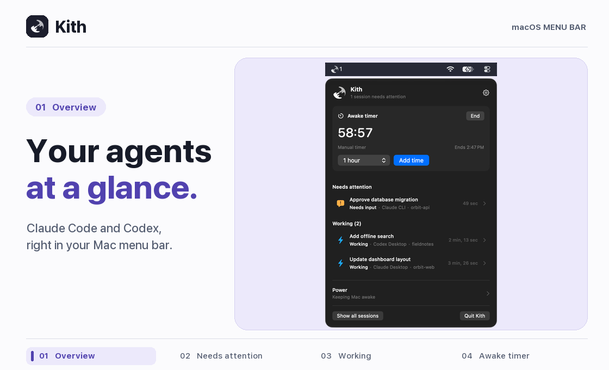
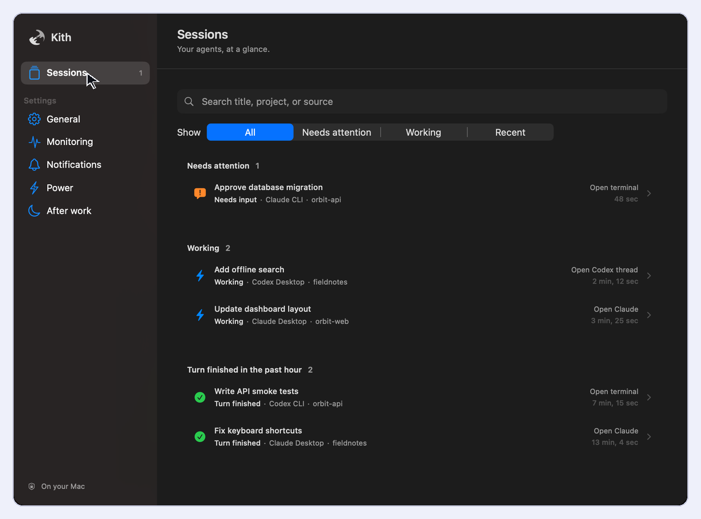

  

<h1 align="center">Kith</h1>

<strong>Claude Code and Codex in your Mac menu bar</strong>

Track CLI and desktop sessions, jump to the work that needs you, and keep your Mac awake.

  

  macOS 14+ · Apple Silicon and Intel ·
  <a href="https://github.com/whysosaket/kith/releases/latest">ZIP and checksums</a> ·
  <a href="docs/USER-GUIDE.md">User guide</a>

  

Kith shown with sample sessions.

## Features

- **Catch approval prompts and failures.** Sessions that need input appear first. Open the right terminal tab or desktop session with one click.
- **Keep your Mac awake.** Hold off idle sleep while agents work or start a timer from the menu bar. Protection ends at its deadline, on low battery, or at critical heat.
- **Decide what happens after work.** Arm sleep or shutdown in **After work**. Kith starts a cancelable countdown once it confirms every session is finished.

Session monitoring runs locally. Kith drops prompts and tool payloads, and marks a session’s status as unconfirmed when it can’t verify it. [Privacy details](docs/USER-GUIDE.md#privacy)

## Get started

1. On **macOS 14 or later** (Apple Silicon or Intel), open the DMG and drag Kith to **Applications**, then open it from there.
2. Open **Kith → Settings → Monitoring**, choose **Install hooks**, and allow Kith notifications in macOS. For Codex, run `/hooks` and trust the new entries.
3. Start a Claude Code or Codex session. Click Kith in the menu bar to see it.

The download is ad hoc signed and predates the redesign. If macOS blocks it, use **System Settings → Privacy & Security → Open Anyway** after attempting to launch it. [Apple’s instructions](https://support.apple.com/102445)

### Install from source

Build with the macOS 26 SDK for the redesigned app. Use a signing identity to enable the optional helper for finish actions and power recovery. Sleep and shutdown require live validation on your Mac. [Build and signing instructions](docs/USER-GUIDE.md#install-from-source) · [Power and safety](docs/USER-GUIDE.md#power-and-safety) · [Live acceptance checks](docs/ACCEPTANCE.md)

## Workspace

  

## Resources

[Permissions and first run](docs/USER-GUIDE.md#first-run) · [Power CLI](docs/USER-GUIDE.md#power-cli-and-startup) · [Troubleshooting](docs/USER-GUIDE.md#troubleshooting) · [Uninstall](docs/USER-GUIDE.md#uninstall)

[Contributing](CONTRIBUTING.md) · [Security](SECURITY.md) · [Changelog](CHANGELOG.md) · [MIT License](LICENSE)

Kith is an independent project. Claude, Claude Code, and Codex are trademarks of their respective owners.
